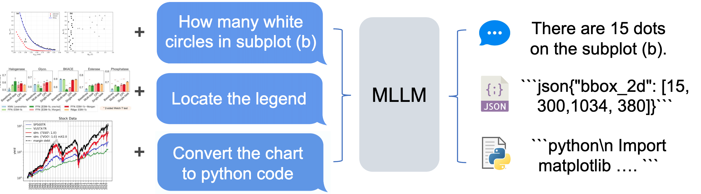
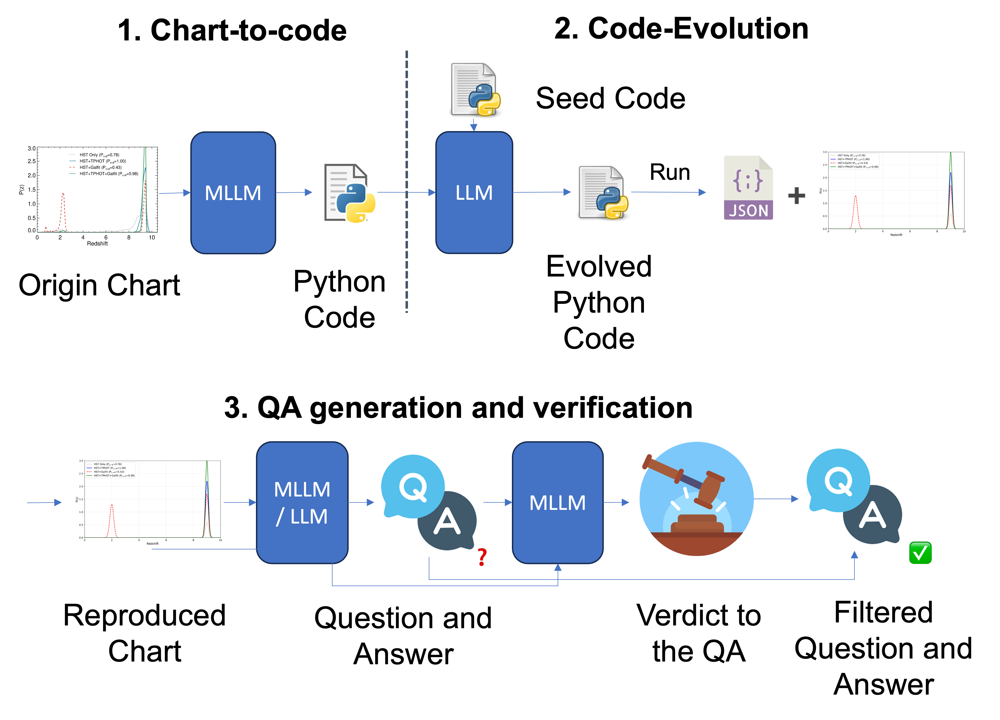
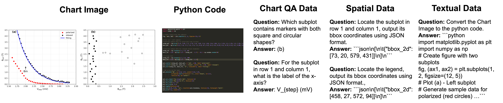
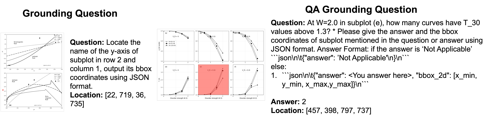
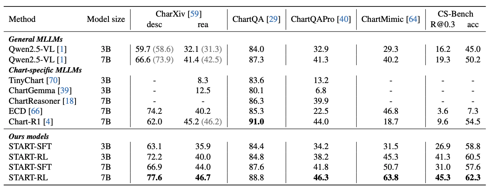

<p align="center">
  
</p>

<h1 align="center">📊 START: Spatial and Textual Learning for Chart Understanding</h1>

<p align="center">
  <a href="https://dragonlzm.github.io/START/"></a>
  <a href="https://arxiv.org/abs/2512.07186"></a>
  <a href="https://huggingface.co/papers/2512.07186"></a>
  <a href="https://huggingface.co/zhuomingliu/START"></a>
  <a href="https://huggingface.co/datasets/zhuomingliu/START-Dataset"></a>
  <a href="https://huggingface.co/datasets/zhuomingliu/CS-Bench"></a>
</p>

<p align="center">
  <a href="https://dragonlzm.github.io/zhuomingliu.github.io/">Zhuoming Liu</a><sup>1</sup>, <a href="https://xfgao.github.io/">Xiaofeng Gao</a><sup>2</sup>, <a href="https://www.linkedin.com/in/feiyangniu/">Feiyang Niu</a><sup>2</sup>, <a href="https://scholar.google.com/citations?user=Ub3LlsgAAAAJ&hl=en">Qiaozi Gao</a><sup>2</sup>, <a href="https://scholar.google.com/citations?user=D3PSmFsAAAAJ&hl=en">Liu Liu</a><sup>3</sup>, <a href="https://scholar.google.com/citations?user=2CkqEGcAAAAJ&hl=en">Robinson Piramuthu</a><sup>2</sup>
  <p align="center"><sup>1</sup>University of Wisconsin-Madison <sup>2</sup>Amazon AGI <sup>3</sup>MIT</p>
</p>


## Introduction
This code repo holds the open-source models and resources reproduced version of START following the method proposed in paper **START**: **S**patial and **T**extual learning for ch**ART** understanding.


### Key Contributions
- **Spatial-Textual Learning**:
  - **(i) Chart-element grounding** — to strengthen an MLLM's understanding of chart visual layout
  - **(ii) Chart-to-code generation** — to enhance understanding of data details

<div align="center">
  
</div>


- **START-Dataset**: A novel data-generation pipeline that first leverages an MLLM to translate real chart images into executable chart code, recovering the underlying data representation while preserving the visual distribution of real-world charts. We then evolve the code with a Large Language Model (LLM) to ascertain the positions of chart elements that capture the chart's visual structure, addressing challenges that existing methods cannot handle.


<div align="center">
  
</div>


- **CS-Bench (Chart Spatial understanding Benchmark)**: A new benchmark to evaluate a model's ability to understand chart spatial structures, filling a critical gap in comprehensive chart understanding evaluation.

<div align="center">
  
</div>


- **State-of-the-art Performance**: Leveraging spatial and textual learning, START delivers consistent gains across model sizes and benchmarks over the base models and surpasses prior state-of-the-art by a clear margin.

<div align="center">
  
</div>


## Contents
- [Install](#1-install)
- [START Dataset](#2-reproduced-start-dataset)
- [CS-Bench](#3-reproduced-cs-bench)
- [Checkpoints](#4-reproduced-checkpoint)
- [Reproduce Results](#5-reproduce-the-results)
- [Training Code](#6-training-code)
- [Contact](#contact)
- [Citation](#-citation)
- [Acknowledgement](#-acknowledgements)


## 1. Install
Please install the environment below to reproduce the model performance on CS-Bench.

```bash
conda create -n qwenvl_env python=3.10
conda activate qwenvl_env

pip install vllm==0.11.0
pip install transformers==4.57.0
# Install Qwen-VL utility library (recommended for offline inference)
pip install qwen-vl-utils==0.0.14
pip install omegaconf
pip install matplotlib ipdb
pip install packaging
pip install ninja
pip install flash-attn==2.8.2 --no-build-isolation
pip install wandb
pip install anls
```


## 2. Reproduced START Dataset

### 2.1 The Raw Code data
You can download the Python Chart codes [here](https://huggingface.co/datasets/zhuomingliu/START_DATASET_RAW/blob/main/generated_code.tar), and all the evolved Python Chart codes [here](https://huggingface.co/datasets/zhuomingliu/START_DATASET_RAW/blob/main/descriptive_evolved_code.tar).

Running these python codes will give you the rendered image and the json file with chart's element location (when you running the evolved code):
```bash
# run all the python chart code: generate rendered image
python data_preprocessing/run_simulated_code.py \
    --code_dir /<YOUR_DATA_DIR>/generated_code \
    --image_dir /<YOUR_DATA_DIR>/simulated_images/ \
    --info_file /<YOUR_DATA_DIR>/simulated_images/all_info.jsonl \
    --save_dir /<YOUR_DATA_DIR>/temp_code/

# run all the evolved python chart code: generate rendered image and json files
python data_preprocessing/run_evolved_code.py \
    --code_dir /<YOUR_DATA_DIR>/descriptive_evolved_code/ \
    --image_dir /<YOUR_DATA_DIR>/evolved_simulated_images/ \
    --info_file /<YOUR_DATA_DIR>/evolved_simulated_images/all_info.jsonl \
    --save_dir /<YOUR_DATA_DIR>/temp_evolved_code/

```


### 2.2 The START Dataset - Annotation and images
You can download the prepared annotations and image [here](https://huggingface.co/datasets/zhuomingliu/START-Dataset/tree/main).

#### Dataset Statistics
| Dataset | # Annotations | # Unique Images |
|---------|---------------|-----------------|
| SFT Annotation | 399,897 | 70,652 |
| RL Annotation | 39,211 | 3,979 |

#### Question Type Distribution (RL Annotation)
In this open-source version, we also includes the point and line training data.

| Question Type | Count | Percentage |
|---------------|-------|------------|
| bbox | 6,694 | 17.07% |
| Number-in-Chart | 6,059 | 15.45% |
| Text-in-Chart | 5,842 | 14.90% |
| Number-in-General | 4,969 | 12.67% |
| Text-in-General | 2,955 | 7.54% |
| dot | 1,764 | 4.50% |
| line | 1,498 | 3.82% |
| chart_to_code | 881 | 2.25% |


#### Question Type Distribution (SFT Annotation)
| Question Type | Count | Percentage |
|---------------|-------|------------|
| Number-in-General | 145,676 | 36.43% |
| Chart to code (With QA) | 111,032 | 27.77% |
| Text-in-General | 68,917 | 17.23% |
| Text-in-Chart | 27,262 | 6.82% |
| Number-in-Chart | 23,284 | 5.82% |
| Multiple Round Agentic | 19,789 | 4.95% |
| Other | 3,937 | 0.99% |

In this open-source version, we also includes the agentic multiple-rounds converation in SFT dataset, sample:
```JSON
{'messages': [{'content': '<image>### Role\nYou are a meticulous chart-analyzing agent.  \nYou may call **Atomic Operations** to gather extra visual evidence, *or* you may answer directly if confident.\n\n### Chart Image\n(see attached image)\n\n### User Question\nHow many subplots show both lines increasing from All Rp to Rp/Re < 10?\n\n### Available Atomic Operations\n1. **CropRegion** – args: `[x_min, y_min, x_max, y_max]`    \n2. **DrawBBox**    – args: `[x_min, y_min, x_max, y_max]`    \n3. **DrawLine**    – args: `[x1, y1, x2, y2]`\n\n### Instructions\nProduce **one** of the two response styles below:\n\n**(A) Plan-and-Act** – if you need operations first\n````\n```json\n[\n  {"op": "<operation_name>", "args": [...], "purpose": "<why>"},\n  …\n]\n```\n````\n\n**(B) Direct Answer** – if no operations are required  \n````\n<think><step-by-step explanation></think>\nThe final answer is: \\boxed{<answer>}\n````\n', 'role': 'user'}, {'content': '```json\n[{"op": "DrawBBox", "args": [62, 429, 468, 761], "purpose": "Highlight the AGN subplot to examine the trend of both lines"}, {"op": "DrawBBox", "args": [62, 37, 468, 368], "purpose": "Highlight the Quiescent subplot for comparison - both lines decrease"}, {"op": "DrawBBox", "args": [554, 37, 961, 368], "purpose": "Highlight the Star Forming subplot for comparison - only control line increases"}, {"op": "DrawBBox", "args": [554, 429, 961, 761], "purpose": "Highlight the Composite subplot for comparison - both lines decrease"}]\n```', 'role': 'assistant'}, {'content': '<image>\nHere are the images base on your operation.\n', 'role': 'user'}, {'content': '<think>By examining each subplot: Quiescent shows both lines decreasing, Star Forming shows only the control line increasing while all pairs decreases, AGN shows both lines clearly increasing from left to right, and Composite shows both lines decreasing. Therefore, only 1 subplot (AGN) shows both lines increasing from All Rp to Rp/Re < 10.</think>\nThe final answer is: \\boxed{1}\n', 'role': 'assistant'}], 'images': ['0905.3386_1_origin.png', '0905.3386_1_6_draw.png']}
```

## 3. Reproduced CS-Bench
Please download the CS-Bench [here](https://huggingface.co/datasets/zhuomingliu/CS-Bench).

### CS-Bench Statistics
| Metric | Value |
|--------|-------|
| Number of Annotations | 692 |
| Number of Unique Images | 600 |

#### Question Type Distribution
| Question Type | Count | Percentage |
|---------------|-------|------------|
| Grounding Question | 350 | 50.58% |
| QA Grounding Question | 342 | 49.42% |

## 4. Reproduced Checkpoint
The following model is trained on the reproduced START dataset initialized with Qwen2.5-VL-7B.

| Models | CharXiv (desc) | CharXiv (rea) |  ChartQAPro | ChartMimic | CS-Bench (Recall@0.3) | CS-Bench (acc) |
|----------|---|---|---|---|---|---|
| [Qwen2.5-VL-7B](https://huggingface.co/Qwen/Qwen2.5-VL-7B-Instruct) | 73.0 | 43.2 | 41.9 | 47.1 | 23.1 | 50.8 |
| [START-RL-7B](https://huggingface.co/zhuomingliu/START) | 78.5 | 47.6 | 47.2 | 69.9 | 48.6 | 65.5 |


## 5. Reproduce Checkpoint Results on Benchmarks
We provide evaluation Code for CS-Bench, [ChartQAPro](https://github.com/vis-nlp/ChartQAPro), [CharXiv](https://charxiv.github.io/), [ChartMimic](https://github.com/ChartMimic/ChartMimic) in this section.

### 5.1 CS-Bench Evaluation
Please refer to [CS-Bench Eval](eval/cs_bench/README.md).

### 5.2 ChartQAPro Evaluation
Please refer to [ChartQAPro Eval](eval/chartqapro/README.md).

### 5.3 CharXiv Evaluation
Please refer to [CharXiv Eval](eval/charxiv/README.md).

### 5.4 ChartMimic Evaluation
Please refer to [ChartMimic Eval](eval/chartmimic/README.md).


## 6. Training Code
Training code will come soon.

## Contact
Zhuoming Liu (zliu2346@wisc.edu)

## 📖 Citation
Please kindly cite our paper if you find this project helpful.

```bibtex
@misc{liu2025startspatialtextuallearning,
      title={START: Spatial and Textual Learning for Chart Understanding},
      author={Zhuoming Liu and Xiaofeng Gao and Feiyang Niu and Qiaozi Gao and Liu Liu and Robinson Piramuthu},
      year={2025},
      eprint={2512.07186},
      archivePrefix={arXiv},
      primaryClass={cs.CV},
      url={https://arxiv.org/abs/2512.07186},
}
```

## 💡 Acknowledgements

This project was built upon the following repositories with many thanks to their authors.

[Qwen2.5-VL](https://github.com/QwenLM/Qwen2.5-VL), [vLLM](https://github.com/vllm-project/vllm)
